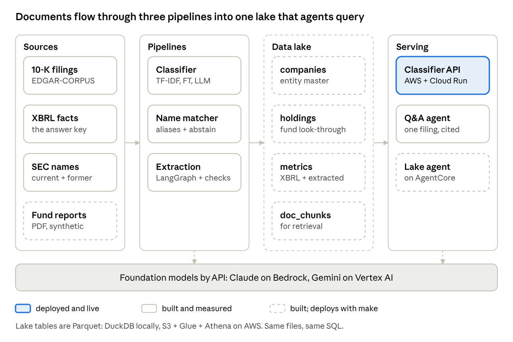

# From fund documents to answers: a working sample on SEC filings

A work sample for a private-markets data science team. It takes documents an investor actually
receives, resolves every company name in them, pulls out the numbers, stores everything in one
queryable lake, and lets an analyst ask questions that come back with sources. Each step is
measured against an answer key, costed, and deployable with one command.

Built by Gurkaran Gulati with [Claude Code](https://claude.com/claude-code) as a pair programmer;
[`CLAUDE.md`](CLAUDE.md) explains how the work was divided.

## Quick links

| Looking for | Links |
|---|---|
| **Data** | [Fund report PDFs](lake/samples/fund_reports) (synthetic) · [labels: true company per reported name](lake/samples/fund_truth.csv) · [57 golden questions with answers](lake/samples/questions.jsonl) · sources: [EDGAR-CORPUS 10-Ks](https://huggingface.co/datasets/eloukas/edgar-corpus) + SEC names and XBRL APIs, rebuilt by [`fixtures/make_companies.py`](fixtures/make_companies.py), [`matching/golden.py`](matching/golden.py), [`extraction/fetch_xbrl.py`](extraction/fetch_xbrl.py), [`lake/funds.py`](lake/funds.py) |
| **Every run** | [`RESULTS.md`](RESULTS.md): one row per run with metrics, cost, latency and links · [`results/all_runs.csv`](results/all_runs.csv): every parameter and metric · console logs: [sectors](sectors/results/logs) · [matching](matching/results/logs) · [extraction and Q&A](extraction/results/logs) · [agent](agent/results) |
| **Full numbers** | Sectors: [all runs](sectors/results/results.csv) · [per-sector precision/recall/F1](sectors/results/tfidf_logreg_per_sector.csv) · [confusion matrix](sectors/results/tfidf_logreg_confusion.csv) · [backtest by year](sectors/results/backtest.csv) · [CV folds](sectors/results/cv_folds.csv) · [split options](sectors/results/split_options.csv) · Matching: [by method and query type](matching/results/eval_test.csv) · Extraction: [by field](extraction/results/eval_graph.csv) · Q&A: [by question type](extraction/results/qa_eval_agent.csv) · Lake: [50 validation checks](lake/results/validate.csv) · Agent: [AWS](agent/results/eval_aws.csv) and [local](agent/results/eval_local.csv) by question · [precision vs. coverage curves](results/precision_coverage.csv) |
| **Per-item predictions** | [Every test filing's sector](sectors/results/llm_classify_bedrock_fewshot5_test_preds.csv) · [every matched name](matching/results/per_item/preds_test_hybrid.csv) · [every Q&A answer with its tool trace](extraction/results/per_item/qa_preds_agent.csv) · example traces: [Q&A](extraction/results/qa_examples.md), [lake agent](agent/results/examples_aws.md) |
| **Infrastructure: AWS** (CDK, Python) | Classifier: [API Gateway + Lambda + SageMaker stack](sectors/deploy/aws/sector_stack.py) · [Lambda handler](sectors/deploy/aws/lambda_fn/handler.py) · Lake: [S3 + Glue + Athena stack](agent/deploy/lake_stack.py) · Agent: [AgentCore Runtime + IAM stack](agent/deploy/agent_stack.py) · [agent container](agent/Dockerfile) · teardown: [classifier](sectors/deploy/TEARDOWN.md), [lake and agent](agent/deploy/TEARDOWN.md) |
| **Infrastructure: Google Cloud** | [Cloud Run deploy script](sectors/deploy/gcp/deploy.sh) · [serving app (FastAPI)](sectors/deploy/app/main.py) · [container](sectors/deploy/app/Dockerfile) |
| **AWS vs. Google, side by side** | [`docs/ARCHITECTURE.md`](docs/ARCHITECTURE.md): services, auth, cold start, idle cost, when to choose which |
| **Decisions and reasoning** | [Decisions](docs/DECISIONS.md) · [Iterations and bugs](docs/ITERATIONS.md) · [Precision vs. coverage dials](docs/DIALS.md) · [Operations: backtesting, cost, monitors, guardrails](docs/OPERATIONS.md) · [Improvements](docs/IMPROVEMENTS.md) · [Security](SECURITY.md) |
| **Run it** | [Get started](#get-started) · [`Makefile`](Makefile) (`make help`) · [Onboarding: accounts, quotas, permissions](docs/ONBOARDING.md) · [CI: secret scan and dependency audit](.github/workflows/security.yml) |

## The problem

A secondaries team buys stakes in private funds. Before each bid, analysts read hundreds of
fund reports and filings about the companies inside those funds, and do the same four jobs
every time:

1. **Know what each company does.** Tag its sector consistently, and keep that model accurate
   as companies and language change from year to year.
2. **Know which company a name means.** Funds write "Actuant Corp" years after the company
   became Enerpac, abbreviate names, or misspell them.
3. **Get the numbers out.** Revenue and net income sit in long documents, sometimes in
   sentences instead of tables.
4. **Answer questions with sources.** For example, "Which of Fund III's holdings lost money
   last year?" A wrong number in a valuation is worse than "I don't know".

**The stand-in data, public and checkable:**
- 5,579 SEC 10-K filings from 2016–2020;
- the SEC's XBRL data as the answer key for numbers;
- the SEC's current and former company names;
- five synthetic fund reports (PDF) holding 54 positions in 50 real companies.

## What I built



| Piece | What it does | Folder |
|---|---|---|
| Sector classifier | Six ways to tag sectors, compared; a walk-forward backtest by year; deployed on AWS and Google Cloud | [`sectors/`](sectors) |
| Name matcher | Resolves a name through renames, typos and abbreviations, as of a date, and abstains when unsure; served as an API | [`matching/`](matching) |
| Extraction graph | A LangGraph flow that extracts, checks every number in code, retries, and sends failures to an analyst | [`extraction/`](extraction) |
| Document Q&A agent | A tool-using agent that answers questions about one filing, with every citation and number verified | [`extraction/qa_agent.py`](extraction/qa_agent.py) |
| Data lake | Fund PDFs + 10-Ks → resolved holdings, XBRL and extracted metrics, and text passages, as Parquet tables | [`lake/`](lake) |
| Lake analyst agent | Answers analyst questions over the lake with guarded SQL and citations; runs locally, or on Bedrock AgentCore with Athena | [`agent/`](agent) |

## How I approached it

- **Score honestly before comparing models.**
  - Split by company, never by filing; otherwise 46% of test filings would have their own
    company in training.
  - Choose settings on validation and open the test set once.
  - Write each decision rule down *before* the run that tests it.
- **Measure cost and latency next to quality.** Every row of every results table has a cost per
  1,000 items, a cost per correct answer, and latency.
- **Favor precision wherever a number or a company link lands.** The system abstains or routes
  to an analyst rather than guess. Retrieval favors recall; precision is enforced afterwards,
  with checks in code.
- **Treat every model output as untrusted.** Schemas, citations, numbers and SQL are all checked
  in code.
- **Make it reproducible.** Every stage is a `make` target, every run is logged, and every
  decision is written down with its alternatives.

## Key decisions

| Decision | Chosen | Over | Why |
|---|---|---|---|
| How to tag sectors | Few-shot LLM for new or changing labels; TF-IDF for bulk | Fine-tuning alone | Few-shot scored 0.782 with no training. TF-IDF is within 3 points at ~$0 |
| What goes in the prompt | 5 similar labeled examples | Hand-written rules | +4.9 points on validation. Examples carry the label convention in the companies' own words |
| Keeping the model current | Retrain yearly on all history | Freeze it | A frozen model loses 8 points on new companies by 2020 |
| Extraction | A fixed graph with checks and an analyst route | One LLM call | 71% vs. 0% of net income within 1% on unflagged filings; it knows when it doesn't know |
| Question answering | A tool-using agent with verification | One call over a fixed window | 91% vs. 72%, and right to say "not there" 95% vs. 57%, at 7× the cost |
| The lake | Parquet; DuckDB locally, S3 + Glue + Athena on AWS | Redshift, Postgres | $0 idle, no servers, the same files and SQL in both places |
| Where the agent runs | Bedrock AgentCore Runtime | Lambda, ECS | Built for long, multi-step agent sessions; deployed by CDK |
| How the agent reads data | Guarded text-to-SQL + retrieval | Pre-built queries only | Answers questions nobody planned for; the guard was tested against 61 attacks |

All twelve decision records, with evidence and "revisit when": [`docs/DECISIONS.md`](docs/DECISIONS.md).

## Results at a glance

Every problem was solved at least two ways and measured on held-out data for **quality,
precision vs. coverage, latency and cost**. The chosen approach is in **bold**. Every run behind
these numbers, with its log and per-item predictions, is in [`RESULTS.md`](RESULTS.md).

### 1. Sector tagging: 7 approaches, 853 held-out filings, 10 sectors

| Approach | Training | Macro precision | Macro recall | **Macro F1** | Accuracy | Latency per filing | Cost per 1,000 |
|---|---|---|---|---|---|---|---|
| TF-IDF + logistic regression | 36 s | 0.794 | 0.730 | 0.751 | 0.746 | 0.002 ms | ~$0 |
| TF-IDF + LR, balanced class weights | 36 s | 0.776 | 0.736 | 0.750 | 0.743 | 0.002 ms | ~$0 |
| Fine-tuned DistilRoBERTa (82M weights) | 3.3 min | 0.759 | 0.763 | 0.758 | 0.753 | 2.5 ms | ~$0 (own compute) |
| LoRA (0.9% of weights) | 1.4 min | 0.758 | 0.740 | 0.744 | 0.734 | 2.7 ms | ~$0 (own compute) |
| Zero-shot Claude Haiku 4.5 | none | 0.776 | 0.757 | 0.748 | 0.743 | 0.61 s | $1.98 |
| Zero-shot Gemini 3.8 Flash | none | 0.783 | 0.793 | 0.781 | 0.770 | 3.4 s | $1.52 |
| **Few-shot Claude (5 retrieved examples)** | **none** | **0.793** | **0.788** | **0.782** | **0.770** | **0.63 s** | **$2.71** |

- **Prompt versions, chosen on validation:** sector list 0.756 → + rules 0.774 → + examples
  **0.804** → rules + examples 0.814. The last was not tested: +1.0 was under the 1.5-point
  noise bar set before the run.
- **Precision vs. coverage dial:** auto-tag at confidence ≥ 0.8 → 71% tagged at **86%
  precision**; ≥ 0.9 → 60% at 91%; tag everything → 100% at 75%.
- **Next year (walk-forward backtest, F1 on companies never seen):**

| Model | 2017 | 2018 | 2019 | 2020 |
|---|---|---|---|---|
| **Retrained yearly on all history** | 0.685 | **0.742** | **0.755** | **0.731** |
| Frozen at 2016 | 0.685 | 0.670 | 0.693 | 0.649 |
| Trained on last year only | 0.685 | 0.721 | 0.708 | 0.653 |

### 2. Name matching: 6 methods, 8,467 held-out names over 9,945 companies

| Method | Top-1 | Top-5 | **Precision when it answers** | Coverage | Renamed companies (top-1) | Latency per name | Cost per 1,000 |
|---|---|---|---|---|---|---|---|
| Exact match after normalizing | 0.716 | 0.719 | 0.716 | 100% | 0.997 | 0.04 ms | $0 |
| Fuzzy string score | 0.939 | 0.997 | 0.939 | 100% | 0.935 | 0.59 ms | $0 |
| TF-IDF character n-grams | 0.968 | 0.988 | 0.968 | 100% | 0.995 | 0.13 ms | $0 |
| TF-IDF without former names | 0.623 | 0.656 | 0.623 | 100% | **0.136** | 0.12 ms | $0 |
| **Hybrid + abstain** (thresholds from dev) | **0.988** | **0.994** | **0.990** | **99.8%** | **0.994** | **0.22 ms** | **$0** |
| Hybrid + Claude re-rank of close calls (dev) | 0.991 | 0.997 | 0.994 | 99.7% | 0.991 | 4.6 ms | $0.03 |

Former-name aliases are the biggest single gain (renamed companies 0.136 → 0.994). The LLM
re-rank adds 0.1 point for 21× the latency.

### 3. Number extraction: 2 designs, 119 filings scored against SEC XBRL

| Design | Revenue: answered / precision | Net income: answered / precision | Sent to an analyst | Median latency | Cost per 1,000 |
|---|---|---|---|---|---|
| One LLM call | 0% / – | 0% / – | 0% | 1.8 s | $4.16 |
| LangGraph flow, accept every value | 55% / 71% | 66% / 86% | 0% | 3.4 s | $7.86 |
| **LangGraph flow, accept only values that pass checks** | **49% / 80%** | **63% / 87%** | **24%** | **3.4 s** | **$7.86** |

The checks removed only wrong revenue values: precision went from 71% to 80%, and no correct
value was lost. Coverage is capped by the data: the public corpus stripped the financial tables.
In the lake build (50 filings), checked extractions agree with XBRL for 82% of revenue and 84%
of net income values.

### 4. Document Q&A: 2 designs, 91 questions on 40 filings

| Design | **Accuracy** | Answered | Precision when it answers | Right to say "not there" | Citations valid | Median latency | Cost per 1,000 |
|---|---|---|---|---|---|---|---|
| One call over a fixed text window | 72% | 38% | 94% | 57% | 100% | 1.2 s | $3.92 |
| **Tool-using agent + code verification** | **91%** | **78%** | **90%** | **95%** | **100%** | **5.8 s** | **$28.38** |

The agent answers twice as many questions, gives up 4 points of precision, and knows when the
answer isn't there, at 7× the cost.

### 5. Data lake and analyst agent: 5 fund reports, 54 holdings, 57 labeled questions

**Lake build:**
- 54 of 54 holdings resolved to the right company (precision and recall 1.000).
- PDF totals reconcile exactly for all 5 funds.
- 50 of 51 checks pass; the one warning is total assets, which the corpus stripped.

| Agent target | **Accuracy** | Entity | Look-through | Aggregation | Financials | Cross-fund joins | Text | Unanswerable | Citations valid | Latency p50 / p90 | Cost per 1,000 |
|---|---|---|---|---|---|---|---|---|---|---|---|
| Local (DuckDB) | 93% | 100% | 100% | 100% | 100% | 50% | 86% | 100% | 95% | 3.6 s / 7.0 s | $13.31 |
| **AWS (AgentCore + Athena)** | **95%** | 100% | 100% | 100% | 100% | 67% | 86% | 100% | 95% | 11.5 s / 21.4 s | $14.84 |

Cross-fund joins are the weak spot. One local answer reported an impossible "152.65% of NAV",
so the next guardrail is a plausibility check on the answer itself.

### 6. Deployment

| Service | Cold start | Warm call | Idle cost |
|---|---|---|---|
| Classifier on AWS: API Gateway → Lambda → SageMaker serverless | 24.3 s | 0.53 s | $0 |
| Classifier on Google Cloud Run | 4.3 s | 0.20 s | $0 |
| Lake agent on Bedrock AgentCore + Athena | — | 11.5 s per question (LLM + SQL) | $0 |

Commentary on each table: [`docs/RESULTS_SUMMARY.md`](docs/RESULTS_SUMMARY.md). The
precision vs. coverage curves behind each dial: [`docs/DIALS.md`](docs/DIALS.md).

## What I learned

1. **How you score decides what you believe.**
   - A filing-level split would have flattered every model.
   - Returning companies score 0.94–0.98, but that is memory, not skill.
   - The backtest, not the test set, says how the model ages.
2. **Five labeled examples in a prompt beat fine-tuning here.** The signal is industry
   vocabulary. For millions of documents, TF-IDF at ~$0 is still the economical choice.
3. **LLM output must be checked in code.** Bedrock didn't enforce tool schemas, and one off-list
   answer cost 6.8 points of macro F1 through the scorer until I fixed both.
4. **Know what your data dropped.** The public corpus stripped every table, and that set the
   ceiling for extraction, not the model.
5. **Verification can be too strict or too loose, and only measurement tells you which:**
   - **Too strict:** the Q&A check cut coverage from 75% to 62% without raising precision.
   - **Too loose:** the lake agent's check passed an impossible "152.65% of NAV". The
     same question came back right (40.6%) on the next run, so plausibility checks are
     needed rather than hoping the model writes the SQL correctly.
6. **Thresholds tuned on easy data are too loose for money.** "Meta Platforms" matched SKYX
   Platforms at a score the tuned thresholds accept.
7. **Most deploy failures are permissions and quotas, not code:**
   - a SageMaker memory quota;
   - a Cloud Run build account without access;
   - Gemini prepaid credits;
   - a Bedrock use-case form.

## What I'd do better

| With more… | I would | Expected effect |
|---|---|---|
| **Time** | Measure retrieval on its own (recall@k against labeled passages) | Know whether a miss is retrieval's fault or the model's |
| | Add plausibility checks on agent answers; fix verification for derived numbers | Catch "152% of NAV"; Q&A coverage back to ~75% at the same precision |
| | Add an ambiguity rule and an adversarial name set for matching | Remove most of the remaining ~1% of wrong links |
| | Run the golden sets in CI on every change | Regressions blocked before they ship |
| **Data** | Real fund reports: scanned, varied layouts, hand-labeled | An honest number for messy documents |
| | About 100 filings per year for the extraction backtest; several quarters of fund reports | Drift you can actually see; point-in-time look-through |
| | GICS labels instead of SIC | Labels that match how investors think |
| **Money** | A larger model only on retries and cross-fund joins; two runs must agree on numbers | Precision up where errors cost most |
| | Bedrock Knowledge Bases + a re-ranker; provisioned concurrency | Better retrieval; no cold starts |
| **Different architecture** | Parse the filing's tables and inline XBRL; use the LLM only where no structure exists | Near-complete numbers at a fraction of the cost |
| | Event-driven ingestion (S3 → EventBridge → parse → lake) and Iceberg tables | New reports land automatically; point-in-time queries built in |
| | Bedrock Guardrails, real auth (IAM / Cognito) instead of an API key, prompt caching | Safer agents, proper access control, much lower agent cost |

Ranked, with how to prove each: [`docs/IMPROVEMENTS.md`](docs/IMPROVEMENTS.md).

## Where to look

| Question | Read |
|---|---|
| Why each choice, and what it beat | [`docs/DECISIONS.md`](docs/DECISIONS.md) |
| The order things were tried, the bugs, and how each was caught | [`docs/ITERATIONS.md`](docs/ITERATIONS.md) |
| Every run: metrics, cost per correct answer, latency, logs, per-item predictions | [`RESULTS.md`](RESULTS.md) · [`results/all_runs.csv`](results/all_runs.csv) |
| Precision vs. recall for every task, measured, and how to flip each dial | [`docs/DIALS.md`](docs/DIALS.md) |
| Backtesting, cost, monitors and guardrails per solution | [`docs/OPERATIONS.md`](docs/OPERATIONS.md) |
| Architecture: AWS vs. Google Cloud, side by side | [`docs/ARCHITECTURE.md`](docs/ARCHITECTURE.md) |
| How each piece works, file by file | [`sectors/README.md`](sectors/README.md) · [`matching/WALKTHROUGH.md`](matching/WALKTHROUGH.md) · [`extraction/WALKTHROUGH.md`](extraction/WALKTHROUGH.md) · [`lake/WALKTHROUGH.md`](lake/WALKTHROUGH.md) · [`agent/WALKTHROUGH.md`](agent/WALKTHROUGH.md) |
| The documents and labels | [`lake/samples/`](lake/samples): fund report PDFs, truth labels, 57 golden questions |
| Every concept used, in plain words | [`docs/THEORY.md`](docs/THEORY.md) |
| Accounts, quotas, permissions, and every error hit | [`docs/ONBOARDING.md`](docs/ONBOARDING.md) |
| How secrets and account details are kept out, how the deployed pieces are locked down, and how that is checked | [`SECURITY.md`](SECURITY.md) |

## Get started

**Requirements:** [uv](https://docs.astral.sh/uv/) (Python 3.14), Node.js (for the AWS CDK),
Docker (for the agent image), and the AWS and Google Cloud CLIs for the deploy steps. One-time
account setup is in [`docs/ONBOARDING.md`](docs/ONBOARDING.md).

```
git clone https://github.com/gurkarangulati/carlyle-alpinvest-interview && cd carlyle-alpinvest-interview
make setup                                                   # install everything
make help                                                    # list every stage

# data: public SEC filings and names (the SEC asks for a contact in the User-Agent)
make data names xbrl SEC_USER_AGENT="Your Name you@example.com"
make test

# experiments (Bedrock needs an AWS profile)
make all PROFILE=<aws-profile>                               # classifier, matching, extraction, Q&A
make lake PROFILE=<aws-profile> && make lake-validate        # the lake from fund PDFs + 10-Ks
make eval-agent PROFILE=<aws-profile>                        # the lake agent on 57 labeled questions
make results-index                                           # rebuild RESULTS.md from the runs

# deploy, check, tear down
make deploy-aws smoke-aws PROFILE=<aws-profile>              # classifier on SageMaker serverless
make deploy-gcp smoke-gcp PROJECT=<gcp-project-id>           # classifier on Cloud Run
make deploy-all PROFILE=<aws-profile>                        # lake (S3, Glue, Athena) + agent (AgentCore)
make ask-aws Q="Which funds hold CSX CORP?" PROFILE=<aws-profile>
make teardown-all teardown-aws PROFILE=<aws-profile>         # remove everything on AWS
make teardown-gcp PROJECT=<gcp-project-id>
```

Nothing account-specific is in the code: the account, profile, project and regions come from your environment or `make` variables ([`SECURITY.md`](SECURITY.md)). `make security-scan` and `make deps-audit` run the same checks as CI.
`make -n <target>` shows what a target runs without running it. Browse the experiment history
with `uv run mlflow ui --backend-store-uri sqlite:///mlflow.db`. Data comes from
[EDGAR-CORPUS](https://huggingface.co/datasets/eloukas/edgar-corpus) (Apache 2.0) and the
SEC's public APIs; nothing in `data/` is committed.

## Repo map

```
sectors/      classifier: split, baseline, CV, backtest, fine-tune, LLM; deploy/ (FastAPI, CDK, Cloud Run)
matching/     name matcher, golden set, evaluation, API
extraction/   extraction graph, document Q&A agent, evaluations
lake/         fund PDFs -> bronze / silver / gold Parquet, validation, golden questions, samples/
agent/        lake analyst agent, DuckDB / Athena backends, AgentCore app, deploy/ (CDK)
docs/         decisions, results summary, dials, operations, architecture, iterations, theory, onboarding
results/      every run's parameters and metrics (all_runs.csv), precision-coverage curves
tests/        220 tests
```

## Limits, stated plainly

- **Labels:** sector labels come from SIC codes; investors use GICS.
- **Data:** the corpus has no tables. The fund reports are synthetic and cleaner than real ones.
  Test sets are small, and differences under about 1.5 points are noise.
- **Production gaps:** the cloud stacks are demos, with API-key auth and no VPC or CI/CD.
  [`docs/ARCHITECTURE.md`](docs/ARCHITECTURE.md) lists what production needs.
