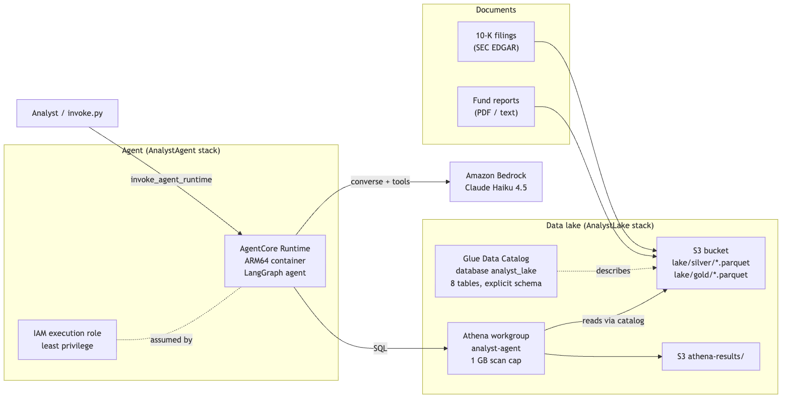

# The analyst agent over the data lake: walkthrough

An analyst types a question ("Which funds hold Valaris?", "What was Corpay's revenue
growth in 2019?", "What does JPMorgan's 10-K say about LIBOR?"). The agent answers from
the data lake only, cites where every fact came from, and says "not in the lake" instead
of guessing. It runs on a laptop against a DuckDB file, and in AWS against the same
tables on S3, through Athena, from a container on Amazon Bedrock AgentCore Runtime.

This builds on two earlier pieces of this repo:
- `extraction/qa_agent.py`: the same agent design (tool loop, 6-call cap, forced
  `final_answer`, verify in code, one revise, human review, trace), but over one 10-K;
- `matching/matcher.py`: the name matcher, now used as the `resolve_company` tool.

---

## 1. Architecture



<details><summary>Diagram source (Mermaid)</summary>

```text
flowchart LR
    subgraph Sources["Documents"]
        K["10-K filings<br/>(SEC EDGAR)"]
        F["Fund reports<br/>(PDF / text)"]
    end
    subgraph Lake["Data lake (AnalystLake stack)"]
        S3["S3 bucket<br/>lake/silver/*.parquet<br/>lake/gold/*.parquet"]
        G["Glue Data Catalog<br/>database analyst_lake<br/>8 tables, explicit schema"]
        A["Athena workgroup<br/>analyst-agent<br/>1 GB scan cap"]
        R["S3 athena-results/"]
    end
    subgraph Agent["Agent (AnalystAgent stack)"]
        RT["AgentCore Runtime<br/>ARM64 container<br/>LangGraph agent"]
        IAM["IAM execution role<br/>least privilege"]
    end
    B["Amazon Bedrock<br/>Claude Haiku 4.5"]
    U["Analyst / invoke.py"]

    K --> S3
    F --> S3
    G -. describes .-> S3
    A -- reads via catalog --> S3
    A --> R
    U -- invoke_agent_runtime --> RT
    RT -- SQL --> A
    RT -- converse + tools --> B
    IAM -. assumed by .- RT
```

</details>

The lake module (`lake/`, built separately) turns documents into Parquet tables. This
module is everything to the right of that: the agent, its tools, and the AWS deployment.

Locally the picture is smaller: `agent/graph.py` → `data/lake/lake.duckdb` (read-only) and
Bedrock. The only switch between the two is `LAKE_BACKEND=local|athena`.

---

## 2. The files, part by part

| File | What it does |
|---|---|
| `__init__.py` | Puts `extraction/` on the import path (at the end, so its `graph.py` can't shadow ours). |
| `schema.py` | The lake contract once: tables, columns, Glue types, one-line descriptions. Used by the prompt, the Glue tables, and the test fixture. |
| `backend.py` | One `query(sql)` interface, two engines: `LocalDuckDB` and `Athena`. |
| `tools.py` | The tools: `run_sql` (with the SQL guard), `resolve_company`, `search_docs`, `describe_tables`, `calculate`. |
| `graph.py` | The LangGraph agent: system prompt, tool schemas, nodes, verify, CLI. |
| `app.py` | The AgentCore Runtime entrypoint (`/invocations`, `/ping` on port 8080). |
| `invoke.py` | Calls the deployed runtime; finds its ARN in the CloudFormation outputs. |
| `evaluate.py` | Runs the golden questions locally or against AWS and scores them. |
| `Dockerfile`, `Dockerfile.dockerignore`, `requirements.txt` | The ARM64 image: only the files and packages the cloud path needs, pinned. |
| `deploy/app.py`, `lake_stack.py`, `agent_stack.py`, `cdk.json` | The CDK app: two stacks. |
| `deploy/TEARDOWN.md` | What `cdk destroy` removes, what it leaves, how to clean that up. |
| `agent.mk` | Make targets, included by the main Makefile. |
| `results/` | `eval_<target>.csv`, `examples.md` (8 traces), run logs. |
| `../tests/test_agent.py` | Guard attacks, backend, verify, call cap with a fake LLM, scoring. |

### `schema.py`: one contract, three users

The model needs the schema to write SQL; Glue needs it to read Parquet; tests need it to
build a fake lake. Writing it three times means three chances to drift, so it lives in one
dict. A test (`test_real_parquet_matches_contract`) also opens the real Parquet files and
checks each column's type against the contract, because Athena fails at query time if a
Parquet `int64` meets a Glue `int`.

### `backend.py`: same SQL, two engines

- **LocalDuckDB** opens an in-memory DuckDB, attaches `lake.duckdb` **read-only**, and
  creates one view per allowlisted table (`companies`, `holdings`, ...). Then it turns off
  external access (no reading files or URLs) and locks the configuration so a query can't
  turn it back on. A timer interrupts any query running over 30 s.
- **Athena** calls `start_query_execution` in the workgroup, polls `get_query_execution`
  (0.25 s, growing to 2 s), stops the query after 30 s, then pages `get_query_results` and
  converts the strings Athena returns back into numbers. Throttling and 5xx are retried
  (same rule as `llm.py`); nothing else is.

**One SQL dialect.** The model writes Presto/Trino SQL, which is Athena's dialect
(Athena engine v3 is Trino). The guard parses it as Trino with `sqlglot` and re-writes it
for the engine, so `approx_percentile` becomes DuckDB's `approx_quantile` locally. Stick to
plain Trino SQL: SELECT, JOIN, GROUP BY, window functions, CASE, CAST, COALESCE, NULLIF.

### `tools.py`: the five tools

**`run_sql(query)`: the main safety point.** `guard_sql` checks the query before anything runs:

1. Length ≤ 4,000 characters; it must parse as Trino SQL.
2. Exactly one statement (`SELECT 1; DROP TABLE x` is two).
3. The top is a SELECT (or SELECTs joined by UNION/INTERSECT/EXCEPT, WITH allowed).
4. No DDL, DML or session command anywhere in the tree: INSERT, DROP, SET, COPY, ATTACH,
   PRAGMA, SELECT INTO, FOR UPDATE, a DELETE hidden in a CTE...
5. Every table is one of the 8 lake tables, or a CTE visible at that point in the query,
   with **no schema prefix**: `information_schema.tables`, `main.secrets`,
   `other_db.users` are all refused.
6. No table functions (`read_csv(...)`, `query(...)`) and no unknown functions
   (`getenv`, `current_setting`); a short allowlist covers safe Trino functions sqlglot
   doesn't know by name.
7. LIMIT 200 is added, or a bigger LIMIT lowered.

Then it runs **sqlglot's regenerated SQL, not the text the model wrote**, so comments
are gone and anything sqlglot didn't understand can't sneak through. Every query gets a
`query_id`; the model cites it as `sql:<query_id>`.

**`resolve_company(name, as_of)`** builds the matching module's hybrid matcher from the
lake's `companies` table: the name plus the `' | '`-joined aliases (former names; short
upper-case aliases like `KO` are indexed as tickers). It returns `cik`, `name`, `score`
and `decision`. On "abstain" the cik is empty and the top candidates are shown. The lake's
aliases have no dates, so `as_of` can't rule out a name yet; it is passed through for
when they do.

**`search_docs(query, cik, fund_id, k)`** loads every `doc_chunks` row through the backend
once, fits TF-IDF (word 1–2-grams, the same recipe as `extraction/qa_tools.py`), and returns
the top passages, optionally for one company or one fund.

**`describe_tables()`** returns the schema text. It is also in the system prompt, so the
model rarely spends a call on it.

**`calculate(expression)`** is imported from `extraction/qa_tools.py`: arithmetic parsed
with `ast`, never `eval`.

### `graph.py`: the agent

```
agent -> (tools -> agent)* -> verify -> done
                                    \-> revise -> agent  (once)
                                    \-> needs_human_review
```

| Node | What it does |
|---|---|
| `agent` | One Bedrock `converse` turn with the tool list. `toolChoice=any` makes it call a tool; after 6 tool calls `toolChoice` is set to `final_answer`, so it must answer. An LLM failure (after `llm.py`'s retries) goes straight to review. |
| `tools` | Runs each requested tool, records what it produced (query ids, chunk ids, numbers, ciks), and sends the results back. Errors (a guard refusal, a bad column) go back to the model as error results so it can fix its query. Calls past the cap are refused. |
| `verify` | Plain code checks on `final_answer` (below). |
| `revise` | Sends the failed checks back as the result of the `final_answer` call; the model may use tools again. Once only. |
| `done` / `needs_human_review` | End states. Review carries the reason. |

**The system prompt** says: you are an analyst; here are the tables and columns; here are
the actual values of the categorical columns (sectors are lower case: `energy`, not
`Energy`; fund ids `F01..F05`), read from the lake at start-up; resolve names before
filtering by cik; cite `sql:<query_id>` and chunk ids; use `calculate` for arithmetic; if
the lake doesn't hold it, say so with `answerable=false`.

The value list was added after the first smoke run: the model filtered `sector = 'Energy'`,
got 0 rows, and spent 2 extra calls. Showing real values is cheaper than any amount of
"be careful with case".

**`final_answer`**: `{answer, answer_value (number | list | string | null), entity_cik,
citations, answerable}`. `answer_value` is what the evaluation scores; `answer` is what a
person reads.

**Verify, in code (no second LLM):**
1. Every citation was produced **in this run**: a chunk id `search_docs` returned, or
   `sql:<id>` of a query this run executed. A made-up or remembered id fails.
2. Every number in the answer appears in a tool result or a `calculate` output, allowing
   for rounding and for how people write money (274,515,000,000 may be "274.5 billion").
   A calculation counts only if its inputs came from tools. Ids such as `F04` or `10-K`
   are not numbers.
3. Entities: `entity_cik` must be a cik a tool returned in this run. If `answer_value`
   names a company the matcher recognizes, that company's cik must also have come back
   from a tool.
4. Shape: answer not empty, `answerable` a real boolean, an answerable answer has at
   least one citation.

**The trace** has one entry per step: each LLM turn (which tools it asked for, tokens,
seconds), each tool call (arguments, a short result, seconds), each verify (the problems).

### `app.py`: the AgentCore entrypoint

`BedrockAgentCoreApp` (SDK `bedrock-agentcore` 1.24; checked in its source) is a small
Starlette app with exactly two routes: `POST /invocations` calls the function marked
`@app.entrypoint` with the JSON body, and `GET /ping` answers health checks. A plain
(non-async) entrypoint runs in a thread pool, so a 5-second agent run doesn't block
`/ping`. `app.run()` binds 127.0.0.1 on a laptop and 0.0.0.0 in a container (the
Dockerfile sets `DOCKER_CONTAINER=1` for that). We validate the payload, run `ask()`, and
log one structured line per question (status, tool calls, tokens, cost, bytes scanned,
query ids; not the conversation).

### The container

`linux/arm64` (AgentCore runs Graviton), `python:3.14-slim`, pinned requirements, non-root
user, port 8080. Build context is `sprint/ml`, but `Dockerfile.dockerignore` (and the same
list in the CDK asset) lets in only `agent/*.py`, the matcher, its tuned thresholds, and
the four `extraction/` files it imports. No data is baked in: the cloud reads the lake
through Athena. No `duckdb` either: the backend imports it only when `LAKE_BACKEND=local`.

### `deploy/`: two stacks

**AnalystLake**
- S3 bucket: blocked public access, SSE-S3, TLS only, `RemovalPolicy.DESTROY` with
  `auto_delete_objects=True` (teardown empties it); results expire after 7 days.
- `BucketDeployment` uploads `data/lake/silver` and `data/lake/gold` to `lake/silver/` and
  `lake/gold/`.
- Glue database `analyst_lake` and one `CfnTable` per contract table: explicit columns
  from `schema.py`, Parquet SerDe, location `s3://<bucket>/lake/<layer>/<table>/`.
  No crawler: crawlers guess types and can change them silently.
- Athena workgroup `analyst-agent`: results in `s3://<bucket>/athena-results/`, engine v3,
  **1 GB bytes-scanned cutoff per query**, settings enforced so a client can't override them.

**AnalystAgent**
- `DockerImageAsset` (ARM64) built and pushed by `cdk deploy`.
- An IAM role only AgentCore in this account can assume, with:
  `bedrock:InvokeModel` on the Haiku 4.5 inference profile and the foundation model in the
  three US regions it routes to; Athena start/get/stop on this workgroup only; Glue get on
  this database and its tables; S3 read on `lake/*`, read/write on `athena-results/*`.
  The L2 `Runtime` construct adds ECR pull, CloudWatch Logs on its own log groups, X-Ray,
  metrics, and its workload-identity token.
- The AgentCore `Runtime` (L2 construct): HTTP protocol, public network mode, 5-minute
  idle session timeout, env `LAKE_BACKEND=athena`, `ATHENA_DATABASE`, `ATHENA_WORKGROUP`,
  `ATHENA_OUTPUT`.
- Outputs: runtime ARN and id, bucket, database, workgroup.

---

## 3. Why each choice, and what else was on the table

### Where the agent runs: AgentCore Runtime vs. Lambda vs. ECS/Fargate vs. Cloud Run

| | AgentCore Runtime (chosen) | Lambda | ECS on Fargate | Cloud Run (GCP) |
|---|---|---|---|---|
| Cost while idle | $0 compute | $0 | Pays for ≥1 task 24/7 (~$30/mo for 1 vCPU/2 GB) + load balancer (~$16/mo) | $0 (scale to zero) |
| Cost per question | CPU billed only while actually used, not while waiting on Bedrock; memory per second | Billed for the whole wall-clock time, including LLM waits | Already paid for | Billed per request time |
| Max run time | Long sessions (hours) | 15 min | Unlimited | 60 min |
| Isolation | Each session in its own microVM | Shared execution environments | Shared tasks | Shared instances |
| Agent features | Sessions, identity, observability built in | None | None | None |
| Operations | Container + one construct | Zip/image, simplest | VPC, ALB, autoscaling to own | Simple, but the lake and Bedrock are in AWS |

Lambda would work for this agent (runs are ~5 s). AgentCore wins on three things that
matter for agents specifically: you don't pay CPU while waiting on the LLM, each user
session is isolated in its own microVM (one user's data can't leak into another's
memory), and long or multi-turn sessions don't hit a 15-minute wall. Fargate is for
steady, high traffic. Cloud Run is the right answer on GCP, but here it would put the
compute in one cloud and the data in another: cross-cloud egress, two identity systems,
more latency. Keep compute next to the data ("data gravity").

### Where the lake is queried: Athena vs. Redshift Serverless vs. RDS/Aurora

| | Athena (chosen) | Redshift Serverless | RDS / Aurora Postgres |
|---|---|---|---|
| Cost while idle | $0 (S3 storage only) | $0 compute, but each query bills a 60 s minimum of RPUs | An always-on instance (Aurora Serverless v2 can pause, with a resume delay) |
| Cost per query | $5 per TB scanned, 10 MB minimum: ~$0.00005 for this lake | Much higher per small query | Already paid for |
| Latency | ~1–2 s per query | Sub-second when warm | Milliseconds |
| Data stays in | S3 Parquet (open format) | Redshift storage (or Spectrum on S3) | The database |
| Operations | Catalog + workgroup | Namespace, workgroup, VPC | Instances, VPC, backups, patching |

The lake is small, read-only and queried a few times per question. Athena costs nothing
when nobody is asking, keeps the data in open Parquet, and the workgroup's scan cap bounds
the cost of a bad query. Redshift makes sense when many analysts run heavy joins all day;
Postgres when the app needs millisecond lookups or writes. Athena's 1–2 s per query is
the price; with 1–3 queries per question it fits inside an LLM-dominated 5 s.

### How the model reaches the data: guarded text-to-SQL vs. pre-built query tools

| | Text-to-SQL with a guard (chosen) | Pre-built tools (`get_fund_exposure(fund_id)`, ...) |
|---|---|---|
| Coverage | Any question the tables can answer | Only the questions someone wrote a tool for |
| Safety | Depends on the guard + read-only engine + IAM | Each tool is a fixed, reviewed query |
| Accuracy | Model can write wrong SQL (wrong filter, wrong join) | Model only picks a tool and arguments |
| Effort | One guard, tested hard | One function per question type |

Analysts ask open questions ("held by more than one fund", "weighted by fair value"), and
pre-built tools would need a new function per question. So the model writes SQL, and
safety is layered so no single layer has to be perfect: the sqlglot guard (one SELECT,
allowlisted tables, no functions that touch files, LIMIT 200), then a read-only engine
(DuckDB attached read-only with external access off; Athena with an IAM role that can't
write to the lake and a 1 GB scan cap), then verify (the answer's numbers must have come
back from a query that actually ran). A common middle ground in production: pre-built
tools for the top 10 questions, guarded SQL for the long tail.

### How it finds text: in-agent TF-IDF vs. Bedrock Knowledge Bases vs. pgvector

| | TF-IDF in the agent (chosen) | Bedrock Knowledge Bases (S3 Vectors or OpenSearch Serverless) | pgvector (Aurora/RDS) |
|---|---|---|---|
| Idle cost | $0 | S3 Vectors: storage only; OpenSearch Serverless: a minimum of capacity units, ~hundreds of $/month | An always-on database |
| Matching | Exact words and phrases ("LIBOR", "opioid") | Meaning (synonyms, paraphrase) | Meaning |
| Moving parts | None: built from `doc_chunks` at start-up | Embedding model, ingestion job, sync | Embedding pipeline, DB |
| Scale | Fine for ~10k chunks in memory | Millions | Millions |

8,490 chunks fit in memory, and analyst questions here name their terms (LIBOR, tariffs,
privacy), which is what word matching is good at. The index builds in a couple of seconds
from the same lake, so retrieval data can never drift from the tables. Move to a Knowledge
Base when the corpus grows past memory or the questions get vaguer ("what worries
management most?"); S3 Vectors keeps idle cost near zero, OpenSearch Serverless when you
need hybrid search at scale; pgvector when you already run Postgres.

### The agent framework: LangGraph vs. Bedrock Agents vs. Strands

| | LangGraph (chosen) | Bedrock Agents | Strands Agents |
|---|---|---|---|
| Control flow | Explicit graph you write: cap, verify, revise, review are nodes | Managed loop; you configure action groups and prompts | Model-driven loop in a few lines |
| Code checks on the answer | A node, before anything is returned | Possible via Lambda hooks, less direct | Possible via hooks/callbacks |
| Where it runs | Anywhere (laptop, AgentCore, Lambda) | Only in Bedrock | Anywhere (AWS's own SDK) |
| Testing | Swap the LLM for a fake; unit-test each node | Needs the service | Fake model possible |

The verify → revise → review path is the point of this design, and LangGraph makes it an
explicit, testable graph (the tests drive it with a fake LLM, no AWS). Bedrock Agents is
less code but hides the loop, which makes "never return an unverified number" harder to
guarantee and impossible to run locally. Strands is a good fit for simpler model-driven
agents and also deploys to AgentCore; we'd lose the explicit graph. AgentCore Runtime is
framework-neutral, so this choice doesn't lock in the hosting.

---

## 4. Security model

- **Who can call it**: `invoke_agent_runtime` is an IAM-authorized API. Only principals
  with `bedrock-agentcore:InvokeAgentRuntime` on this runtime can call it. There's no
  public URL.
- **What the agent can do (IAM role)**: call Haiku 4.5; run Athena queries in one
  workgroup; read one Glue database; read `lake/*`; write only `athena-results/*`. It
  can't write to the lake, read other buckets, or call other models. Only AgentCore in
  this account can assume the role (source account/ARN conditions).
- **What a query can do (SQL guard)**: one SELECT over 8 tables, LIMIT 200, no file or
  system functions, no other schemas; the regenerated SQL runs, not the model's text.
  Locally DuckDB is read-only with external access off; in AWS the workgroup's 1 GB scan
  cap stops runaway queries.
- **No write paths**: no tool writes anything. The worst a prompt injection hidden in a
  document chunk can do is make the agent run more read-only queries, inside the call cap.
- **What the answer can claim (verify)**: citations must exist in this run; numbers must
  come from tools; entities must be tool-returned ciks. Failures go to human review rather
  than to the user as fact.
- **Logs**: one structured line per question in CloudWatch (status, tool calls, tokens,
  cost, bytes scanned, query ids). Prompts and answers are not logged; Athena keeps the
  SQL history in the workgroup, so `sql:<query_id>` citations can be audited.
- **Isolation**: each AgentCore session runs in its own microVM, discarded when it ends.

## 5. Cost

**While idle** (deployed, nobody asking): about **$0.10 a month**. AgentCore bills
nothing without sessions, Athena nothing without queries. What's left is storage: the
image in ECR (a few hundred MB, ~$0.03–0.05), a few MB of Parquet in S3 (cents), Glue catalog (free tier),
and logs.

**Per question**, measured on the smoke set (10 golden questions, local backend):
- Bedrock Haiku 4.5: ~3–4k input tokens per turn, 2–4 turns: **~$0.010 per question
  ($10 per 1,000)**. This is almost all of the cost.
- Athena: 1–3 queries at the 10 MB minimum: ~$0.0001.
- AgentCore: a few seconds of memory and under a second of active CPU: ~$0.0001.

**Levers**: prompt caching for the long system prompt (the schema repeats every turn);
fewer turns (most questions take 1–2 tool calls); a cheaper model for routing. The 1 GB
scan cap and the 6-call cap bound the worst case per question at well under $0.10.

Check prices on the AWS pricing pages before quoting them; they change.

## 6. Commands, in order

From `sprint/ml`, with `PROFILE=<your aws profile>` (or `AWS_PROFILE` exported).

```bash
# 0. Tests: no AWS, no LLM
make agent-test

# 1. Local (Bedrock for the LLM, the lake from data/lake/lake.duckdb)
make ask Q="Which funds hold CSX CORP?"
uv run python agent/graph.py --mermaid                        # the graph diagram
make agent-serve                                              # then, in another terminal:
curl -s localhost:8080/invocations -H 'Content-Type: application/json' \
     -d '{"prompt": "Which fund has the largest NAV?"}'
make eval-agent                                               # all golden questions, MLflow "agent"
uv run python agent/evaluate.py --target local --limit 5      # quick run, no MLflow

# 2. Deploy (read deploy/TEARDOWN.md first)
make agent-synth                     # CloudFormation only, no AWS calls
make deploy-lake                     # S3 + Parquet + Glue + Athena
make deploy-agent                    # ARM64 image + AgentCore Runtime (needs Docker running)
# or: make deploy-all

# 3. Validate in AWS
make ask-aws Q="Which fund has the largest NAV?"
make eval-agent TARGET=aws

# 4. Teardown (agent first, then lake; then the leftovers from TEARDOWN.md)
make teardown-all
```

## 7. Interview questions

**1. Why an agent and not one SQL-generating prompt?**
Questions need several steps: resolve "Ensco Rowan" to Valaris's cik, then query
holdings, then sometimes compute. A single prompt guesses the cik or filters by name text
and misses renamed companies. The agent picks each step after seeing the last result, and
code bounds it (6 calls, verify, one revise).

**2. How do you stop the model from running destructive SQL?**
Layers. The guard parses with sqlglot and allows only one SELECT over 8 allowlisted tables,
no schema prefixes, no table functions, LIMIT 200, and runs its own regenerated SQL. The
engine is read-only (DuckDB attached read-only with external access off; in AWS an IAM
role with no write on the lake and a 1 GB scan cap). 61 attack cases are tests. No single
layer has to be perfect.

**3. How do you know the answer isn't hallucinated?**
Verify checks in code that every cited query id or chunk id was produced in this run,
that every number in the answer came back from a tool or a checked calculation, and that a
company answer is a cik a tool returned. One revise, then human review with the reason.
It can't prove the SQL asked the right question; that's what the golden set measures.

**4. Why Athena?**
Read-only, small, bursty: $0 idle, ~$0.00005 per query here, open Parquet on S3, and the
workgroup caps bytes scanned. Redshift if many analysts run heavy joins all day; Postgres
if we need millisecond lookups or writes.

**5. Why AgentCore Runtime over Lambda?**
CPU isn't billed while the agent waits on Bedrock, which is most of an agent's time;
sessions are isolated in microVMs; no 15-minute limit; built-in identity and observability.
Lambda would work at this size. Fargate only for steady high traffic.

**6. What does it cost?**
~$0.10/month idle (image and Parquet storage). ~$0.01 per question, nearly all Bedrock
tokens. Biggest lever: prompt caching for the repeated schema in the system prompt.

**7. The same SQL on DuckDB and Athena: how?**
The model writes Trino SQL. sqlglot parses it as Trino and regenerates it for the engine,
so dialect differences (approx_percentile vs. approx_quantile) are handled in one place.
Both engines see the same 8 table names: DuckDB through views, Athena through Glue.

**8. How does entity resolution work, and when does it refuse?**
The hybrid matcher: TF-IDF on character n-grams finds 20 candidates, rapidfuzz re-scores
them against every alias (former names included), and it abstains when the best score is
under the tuned threshold or the runner-up is too close. Abstaining is a feature: "two
First National Banks" should go to a person, not be a coin flip.

**9. Why TF-IDF and not a vector store?**
8.5k chunks, questions that name their terms (LIBOR, tariffs): word matching is exact,
needs no embedding pipeline, costs $0 idle, and can't drift from the tables because it's
built from the same lake. A Knowledge Base on S3 Vectors when the corpus outgrows memory or
questions get vaguer.

**10. What would you add for production?**
Per-user authorization (JWT on the runtime, row filters by entitlement via Lake Formation);
prompt caching; an eval gate in CI on the golden set; online evaluation on live traffic;
alarms on review rate and Athena bytes scanned; partitioning the lake by year when it grows;
pre-built tools for the most common questions.

**11. What breaks first at scale?**
The in-memory TF-IDF index (memory and start-up time per microVM), then Athena's per-query
latency and its concurrent-query quota. Fixes: a managed vector index, caching repeated
queries, and partitioned Parquet so queries scan less.

## 8. Known weaknesses

- Verify checks that numbers came from tools, not that the SQL was the right SQL: a wrong
  filter gives a "verified" wrong answer. The golden set is the check for that.
- The number check is generous (any tool number, at several scales), so a coincidental
  match can pass.
- `as_of` in `resolve_company` doesn't filter yet: the lake's aliases have no dates.
- The TF-IDF index loads all of `doc_chunks` through Athena on each cold start (one full
  scan, ~1–3 s, cents per thousand cold starts).
- The image includes `mlflow-skinny` and `pandas` only because `extraction/common.py`
  (imported by `qa_tools.py`) imports them.
