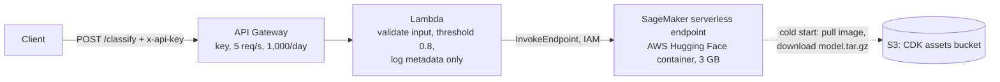
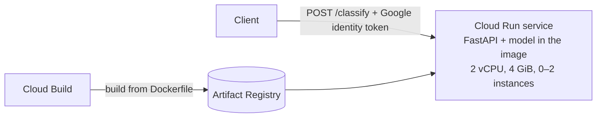

# Architecture: the same model served on AWS and Google Cloud

The fine-tuned DistilRoBERTa classifier is deployed twice, and both deployments were
measured.

## AWS: API Gateway → Lambda → SageMaker serverless (CDK, Python)

`sectors/deploy/aws/sector_stack.py` creates 17 resources; the numbered comments follow the
flow:

| # | Resource | Job |
|---|---|---|
| 1–2 | S3 asset | CDK uploads `model.tar.gz` to its bootstrap bucket |
| 3 | IAM role for SageMaker | Read that one object, pull the image, write logs |
| 4 | `CfnModel` | Which container runs which weights (`HF_TASK=text-classification`) |
| 5 | `CfnEndpointConfig` | *How* it runs: serverless, 3,072 MB, max concurrency 2 |
| 6 | `CfnEndpoint` | The live endpoint |
| 7 | Lambda | The business rule; its role may call **only** this endpoint |
| 8 | API Gateway REST API | HTTPS entry point, API key, usage plan, throttling |

## Google Cloud: one Cloud Run service (container from source)

`sectors/deploy/gcp/deploy.sh` copies the model into the image and runs
`gcloud run deploy --source`. Cloud Build builds the image on Google's machines, pushes it to
Artifact Registry, and Cloud Run serves it. The service is private
(`--no-allow-unauthenticated`), so callers present an identity token and IAM decides.

## Side by side

| | AWS | Google Cloud |
|---|---|---|
| Pieces | API Gateway + Lambda + SageMaker (+ S3, IAM) | Cloud Run (+ Cloud Build, Artifact Registry) |
| Who wrote the serving code | AWS's Hugging Face container serves the model | Our FastAPI `main.py` in our own container |
| Auth | API key (metering) | IAM identity token (real authentication) |
| Business rule | In the Lambda | In the FastAPI app |
| Infrastructure as code | CDK stack (Python → CloudFormation) | One `gcloud` command (Terraform for production) |
| Cold start (measured) | 24.3 s | 4.3 s* |
| Warm call (measured) | 0.53 s | 0.20 s |
| Idle cost | $0 | $0 (`--min-instances 0`) |
| First-deploy blocker | Account quota: 3,072 MB per serverless endpoint | Build service account lacked `roles/run.builder` |

\*Measured soon after the deploy, so it may not be a full cold start. Measure again after
20 minutes or more of idle time.

**Why AWS was slower to wake up:** on a cold start, SageMaker serverless pulls a large
generic container and downloads and unpacks `model.tar.gz` from S3. Cloud Run's image already
contains the model. Every AWS request also passes through two more hops.

**When to choose which:**
- SageMaker brings model-specific tooling: the model registry, blue/green deployments with
  automatic rollback, production variants for A/B tests, and Model Monitor.
- Cloud Run is the simplest home for any container.
- On AWS, the Cloud Run equivalent would be App Runner, or Lambda with a container image.

## Foundation models: APIs, not hosts

| | AWS | Google Cloud |
|---|---|---|
| Service | Bedrock (`converse`) | Vertex AI / Agent Platform (`google-genai`, `vertexai=True`) |
| Models used | Claude Haiku 4.5 | Gemini 3.8 Flash |
| Auth | IAM (`bedrock:InvokeModel`) | IAM (Application Default Credentials locally, a service account in production) |
| Billing | Per token, through the AWS account | Per token, through Cloud Billing |
| Setup gotcha | One-time Anthropic use-case form | The AI Studio API key bills prepaid credits; Vertex uses Cloud Billing |

## Making it production-ready

- **Auth:** replace the API key with IAM, Cognito or a Lambda authorizer.
- **Cold starts:** provisioned concurrency, or an always-on instance, if users wait on the
  answer. Serverless is fine for batch jobs.
- **New model versions:** a new Model and EndpointConfig, then `UpdateEndpoint` under the
  same name, so SageMaker does a blue/green swap with alarms and auto-rollback. On Cloud
  Run, a new revision with a traffic split.
- **Monitoring:**
  - the `analyst_review` rate (a rising rate is the first sign of drift);
  - new-company F1 each year;
  - `Invocation5XXErrors`;
  - `ModelSetupTime` (cold starts).
- **Logs** never hold the document text, only its length, sector and route.
- **Quotas and IAM** go on the pre-deploy checklist; both first deploys failed on them.
- **Teardown:** `sectors/deploy/TEARDOWN.md`.
