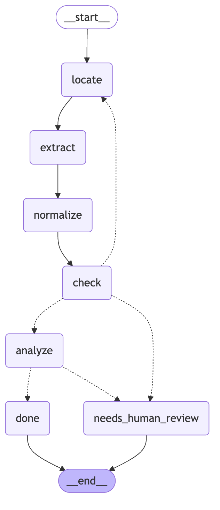
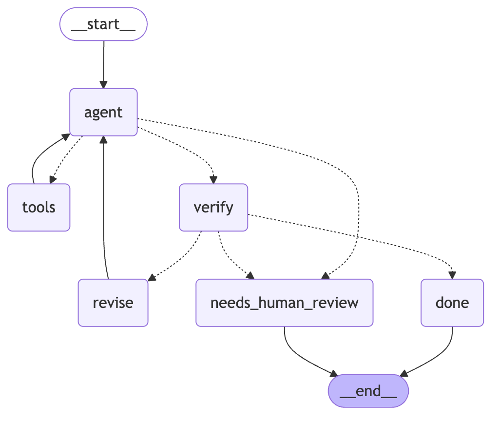

# Extraction walkthrough: pulling financial numbers out of 10-Ks, and checking them

## 1. The problem

A secondaries team buys stakes in private funds. Before a bid, it reads a pile of
reports about the companies inside each fund: annual reports, quarterly letters,
capital account statements. The first job is always the same: pull out a few key
numbers (revenue, net income, total assets), put them in a table, and compare them
to peers.

Doing this by hand is slow. Doing it with an LLM is fast, but an LLM can be wrong
in quiet ways: it reads last year's column, it misses "(in thousands)", or it
makes up a number. A wrong number in a valuation model is worse than a missing one.

So the goal here is not only "extract". It is **extract, check, and say when you
are not sure**. Every filing ends in one of two states:

- `done`: the numbers passed every check, and an analyst note was written;
- `needs_human_review`: something failed, and the reason says what.

We practise on public 10-K filings because they come with an answer key.

## 2. The answer key: XBRL

Since about 2011, US public companies file their statement numbers twice: once as
the document people read, and once as tagged data called **XBRL**. Each number has
a tag (`Revenues`, `NetIncomeLoss`, `Assets`), a period, and the ID of the filing
it came from (the accession number). The SEC serves all of a company's tagged
facts as one JSON file. `fetch_xbrl.py` downloads it and keeps only what we score.

That gives us the true value for each filing, so we can measure accuracy instead
of eyeballing it.

Limits of XBRL as truth:

- **Company-specific tags.** Revenue has no single tag. We try four in order
  (`Revenues`, `RevenueFromContractWithCustomerExcludingAssessedTax`,
  `SalesRevenueNet`, `RevenuesNetOfInterestExpense`). Some companies use their
  own extension tags, so revenue is missing for them.
- **Banks.** Banks often report no "Revenues" at all; they report interest income
  and non-interest income. So bank revenue is often missing from the truth.
- **Restatements.** A later filing can restate last year's number. We take values
  from the original filing, which matches the text we read.
- **Mis-tagged years.** Some filers tag the fiscal year wrongly, so a filing does
  not match, or matches the wrong year.
- **Missing XBRL.** Some small filers have no XBRL for some years.

### How a filing is matched to its XBRL facts

Best case is the accession number: every fact carries the `accn` of the filing it
came from. Our text corpus (EDGAR-CORPUS) does **not** have one; its `filename`
is just `{cik}_{year}.htm`. So the rule is:

1. Keep facts from a 10-K (or 10-K/A, 10-KT) with fiscal period `FY`.
2. Keep facts whose fiscal year `fy` equals the corpus `year`.
3. Pick one filing: the original 10-K before amendments, then the earliest filed.
   From then on use only that accession, so all numbers come from one document.
4. In that filing, take the latest period. For revenue and net income the period
   must be about a year long (330-400 days).
5. Prior-year revenue (for growth) is the comparative number in the same filing.

Is the corpus `year` the filing year or the fiscal year? We checked. It behaves
like the **fiscal year**: the latest year discussed in Item 7 equals `year` in
about 85% of filings, and the matched period ends inside `year` for about 95% of
matches. The rest end in January to March of `year`+1 (retailers and other
companies with early-year fiscal ends).

Result over all 5,579 filings in `companies.csv` (3,968 companies fetched, 43 with
no XBRL at all):

| Match outcome | Filings |
|---|---|
| matched (10-K, `fy` = year, `FY`) | 5,246 (94.0%) |
| company has XBRL, but no 10-K tagged with that fiscal year | 199 |
| no usable XBRL for our concepts | 134 |

Of the matched filings, revenue is found for 72% (banks and custom tags are most
of the gap), net income for 91%, total assets for 99%, prior-year revenue for 69%.
The revenue tag used: `Revenues` 2,299, `RevenueFromContract...` 927,
`SalesRevenueNet` 537, `RevenuesNetOfInterestExpense` 8.

### The sample (`sample.py`)

| Step | Count |
|---|---|
| test-split filings | 853 (599 companies) |
| with XBRL revenue or net income | 774 |
| with Item 7 or Item 8 text (500+ characters) | 841 |
| eligible (both) | 768 filings, 552 companies |
| one filing per company, stratified by sector, seed 14 | **119** |

By sector: industrials 22, healthcare 21, financials 18, technology 15, consumer 14,
materials 9, real estate 8, energy 5, communications 4, utilities 3. In 51 of the
119, Item 8 is a stub and the statements sit in Item 15. Truth exists for revenue
in 82, net income in 111, total assets in 117, prior-year revenue in 78.

## 3. A surprise in the data: the tables are gone

EDGAR-CORPUS turned the filings into plain text and **dropped the HTML tables**.
The statement headings survive ("Consolidated Balance Sheets"), but the rows of
numbers do not. In one year of filings, a table-style "Total assets 1,234,567"
appears in 1 of 669 filings.

So the numbers we can still find are inside sentences, mostly in Item 7 (MD&A):

> Revenues increased 8% to $412.3 million in fiscal 2018.

What this means:

- Revenue and net income are often written in prose (about 60% of filings).
- Total assets is rarely written in prose (about 8%). Expect low coverage for it.
- Prose numbers are rounded ("$412.3 million"), so "within 1%" is strict; "within
  5%" is the fairer bar for this corpus.
- In real work you would read the HTML or PDF tables directly. This corpus makes
  the task harder than it needs to be, which is fine for comparing methods: both
  methods face the same text.

## 4. The files

| File | What it does |
|---|---|
| `common.py` | Paths, loading the companies and the filing texts, MLflow setup. |
| `fetch_xbrl.py` | Downloads XBRL facts (rate-limited, resumable), and matches a filing to its truth. |
| `sample.py` | Picks ~120 test-split filings, one per company, stratified by sector. |
| `llm.py` | The only place that calls Bedrock: retries, circuit breaker, token counts. |
| `checks.py` | Code-only checks: parse numbers, apply scale, evidence, plausibility, year. |
| `analysis.py` | Ratios, sector medians, robust z-scores, the note's facts, the grounding check. |
| `graph.py` | The LangGraph flow: state, nodes, edges. Also runs one filing or prints the diagram. |
| `evaluate.py` | Runs the baseline or the graph on the sample and scores both against XBRL. |
| `../tests/test_extraction.py` | Unit tests for every code-only check. |
| `qa_tools.py` | Part 2: the Q&A agent's tools (TF-IDF search, extracted financials, safe calculator). |
| `qa_agent.py` | Part 2: the Q&A agent as a LangGraph tool-calling loop with a verify step. |
| `qa_scoring.py` | Part 2: how numeric answers are read and graded, abstention included. |
| `qa_eval.py` | Part 2: the agent against a single-call baseline. |
| `../tests/test_qa.py` | Part 2: unit tests for the tools, the checks and the grading. |

## 5. The graph



<details><summary>Diagram source (Mermaid)</summary>

```text
graph TD;
	__start__([<p>__start__</p>]):::first
	locate(locate)
	extract(extract)
	normalize(normalize)
	check(check)
	analyze(analyze)
	done(done)
	needs_human_review(needs_human_review)
	__end__([<p>__end__</p>]):::last
	__start__ --> locate;
	analyze -.-> done;
	analyze -.-> needs_human_review;
	check -.-> analyze;
	check -.-> locate;
	check -.-> needs_human_review;
	extract --> normalize;
	locate --> extract;
	normalize --> check;
	done --> __end__;
	needs_human_review --> __end__;
	classDef default fill:#f2f0ff,line-height:1.2
	classDef first fill-opacity:0
	classDef last fill:#bfb6fc
```

</details>

Solid arrows always happen. Dotted arrows are choices (conditional edges).
LangGraph drew this itself: `uv run python extraction/graph.py --mermaid`.

### The state

The state is a typed dictionary (`FilingState`). It holds the inputs (the filing's
text, its sector, last year's revenue), and each node adds what it found. A node is
a plain function: it takes the state and returns only the keys it changed.

Three keys use a **reducer** (`operator.add`): `tokens_in`, `tokens_out` and
`trace`. Instead of replacing the old value, LangGraph adds the new one to it. So
`trace` ends up as the list of every node that ran, in order, for example
`locate > extract > normalize > check > locate > extract > normalize > check > needs_human_review`.
That is the flow's audit log.

### Node by node

**`locate` (code).** A 10-K is 100,000+ characters. Sending all of it costs more and
buries the numbers. So we cut Items 8, 7 and 15 into 2,000-character pieces and
score each piece with weighted patterns: a revenue, net income or total assets
phrase followed by a dollar amount in the same sentence scores highest; statement
headings and "in thousands" score a little. We send the best pieces, up to 8,000
characters, in reading order, each labeled with where it came from.
On a retry, we keep the best piece, add the piece after it (a passage may run past
a cut), and fill up to 12,000 characters with pieces not shown before.

Why Item 15? Many small companies write "see Item 15" in Item 8 and put their
statements at the back of the filing.

**`extract` (LLM).** One call to Claude Haiku 4.5 on Amazon Bedrock (`converse`).
We **force a tool**: the model must answer by filling a JSON schema. For each field
it returns the value as written ("412.3"), the scale ("millions"), and a short
verbatim quote (the **evidence**). The schema is flat (`revenue_value`,
`revenue_scale`, `revenue_evidence`, ...). A first version used one nested object
per field, and in testing the model sometimes sent that object back as a string of
XML-like text. That is the schema not being enforced, live; flat keys fixed it. It also returns the fiscal year end. Temperature
is 0. On a retry, the prompt also lists the checks that failed last time.

**`normalize` (code).** Turns "(1,234)" + "thousands" into -1,234,000. Brackets mean
minus, as in accounting tables. A scale word inside the value ("1.2 billion") wins
over the scale field. Anything that does not parse becomes empty, not a guess.

**`check` (code).** Bedrock does not strictly enforce the tool schema, and a
well-formed answer can still be wrong. So code checks:

1. *Evidence:* the quote really is in the text the model saw (exact after tidying
   spaces and case, or a 95+ fuzzy match), and the number is in its quote.
2. *Plausibility:* total assets above zero; revenue not negative; no ratio between
   revenue, net income and assets above 100x. The limit is loose on purpose: it
   catches a 1,000x scale slip, not an unusual business.
3. *Year:* the fiscal year end falls in the filing's year (or early the next year).
   A date a year earlier usually means the model read last year's figure.
4. Something was found at all.

**The conditional edge after `check`.** Passed: go to `analyze`. Failed, and no retry
yet: go back to `locate` for a wider, different window. Failed again: go to
`needs_human_review`, with the failed checks as the reason. One retry is the
budget: a second try fixes a bad window; a third rarely helps and doubles cost.

**`analyze` (code, then LLM, then code).**

- Code computes ratios from the extracted numbers: net margin (net income /
  revenue), return on assets (net income / total assets) and, where XBRL has last
  year's revenue, revenue growth.
- Code flags outliers against the sector. This is **a simple statistical model**:
  for each sector we take the median and the MAD (median absolute deviation) of
  each ratio over the XBRL values of the train and val companies. A filing's
  **robust z-score** is `0.6745 × (value − median) / MAD`. Above 3.5 in size is an
  outlier. Medians and MAD are used instead of mean and standard deviation because
  a few wild values (a tiny company with a huge loss) would drag the mean around.
- The LLM writes a 2-3 sentence analyst note, given **only** the computed,
  pre-formatted numbers, and told to copy them exactly.
- Code then finds every number in the note and checks it is in the computed set.
  A rounded or invented number ("about 3%", "up 12%") flags the note.

**`done` / `needs_human_review`.** End states. Each sets `status` and a `reason`.

### The robustness around the LLM call (`llm.py`)

- **Retry only what can clear up:** throttling (429) and server errors (5xx), with
  waits of 2, 4 and 8 seconds plus jitter. An "access denied" fails at once.
- **Circuit breaker:** after 10 failed calls in a row, stop calling. A broken quota
  will not fix itself, and hammering it wastes time.
- **A small thread pool** (`--workers 4`) runs several filings at once, because a
  call mostly waits on the network. Progress prints with an ETA.

## 6. Why a graph and not one prompt

One prompt is simpler and is the baseline. The graph adds:

- **Retries with a reason:** a failed check goes back with a better window and the
  list of what failed.
- **Checks in code:** the model's claims (a quote, a year, a scale) are verified,
  not trusted.
- **A human-review route:** the system can say "I am not sure". That makes the
  numbers it does return more trustworthy. Accuracy on non-flagged filings is the
  number that matters to a team that will act on them.
- **Observability:** every filing has a trace of the nodes it went through, the
  failed checks, and tokens used. Each step is a plain function you can test.

The price: more code, and about 1.3-2x the tokens of one call (retries and the note).

## 7. Options considered

| Option | Good | Bad |
|---|---|---|
| Regex or table parsing | Free, fast, exact when the layout is known | Layouts vary a lot; here the tables are gone, and prose has endless phrasings |
| One LLM call (baseline) | Ten minutes to build; cheap | No idea when it is wrong; reads whatever is first (often the audit letter) |
| **The graph (chosen)** | Checks, a retry, a review route, a trace | More code; extra calls on retries |
| A bigger model | Better reading of messy text | Several times the cost; the checks are still needed |
| Few-shot examples | Teaches the formats ("net loss of $4.2 million" → -4.2) | Longer prompts; examples can over-steer |

The usual order: get the graph and its checks right with a small model, measure,
then try few-shot or a bigger model only on the fields that still fail.

## 8. Weaknesses and failure modes

- **Tables were stripped from this corpus.** Total assets is rarely in prose, so
  its coverage is low. Real documents would need a table parser or the PDF/HTML.
- **Rounded prose numbers** ("$1.2 billion") miss the 1% bar even when right.
- **Signs.** "Net loss of $4.2 million" must become -4.2; if the model forgets,
  the value is right in size but wrong in sign (`sign_errors` counts these).
- **Revenue definitions differ:** "total revenues" vs "net revenues" vs segment
  revenue; the model can pick a sub-total that the XBRL tag does not use.
- **The evidence check proves the quote exists, not that it is the right line.**
  A real quote about segment revenue passes.
- **Plausibility limits are loose** (100x). They catch scale slips, not subtle errors.
- **The year check uses the corpus year**, which is itself inferred.
- **Truth gaps:** banks and custom tags give no revenue truth, so those filings
  are not scored on revenue.
- **Sector medians use XBRL from other companies**, which is fine for flagging,
  but a sector with few companies (energy, communications) has a noisy median.
- **The baseline reads the first 8,000 characters of Item 8**, which is usually the
  auditor's letter. That is what "no locate" means, but it makes the baseline look
  worse than a baseline on Item 7 would.
- **Small sample** (~120 filings): differences of a few points are noise.

## 9. How to run it, in order

From the repo root. Set the SEC User-Agent to your own name and email, and
`AWS_PROFILE` to a profile with Bedrock access in us-east-1.

```bash
# 1. Ground truth: XBRL facts for every company (data prep; ~10 min, resumable)
SEC_USER_AGENT="Your Name you@example.com" uv run python extraction/fetch_xbrl.py

# 2. The evaluation sample (~120 filings) -> data/extraction_sample.csv
uv run python extraction/sample.py

# 3. Unit tests (no network)
uv run pytest tests/test_extraction.py -q

# 4. Look at the flow: the diagram, then one filing end to end
uv run python extraction/graph.py --mermaid
AWS_PROFILE=<your-profile> uv run python extraction/graph.py --cik <cik> --year <year>

# 5. Smoke tests (5 filings each; not logged to MLflow; written to extraction/out/smoke/)
AWS_PROFILE=<your-profile> uv run python extraction/evaluate.py --variant baseline --limit 5
AWS_PROFILE=<your-profile> uv run python extraction/evaluate.py --variant graph --limit 5

# 6. The full runs (119 filings each, a few minutes each, about $1.50 together)
AWS_PROFILE=<your-profile> uv run python extraction/evaluate.py --variant baseline
AWS_PROFILE=<your-profile> uv run python extraction/evaluate.py --variant graph

# 7. Compare runs in MLflow
uv run mlflow ui --backend-store-uri sqlite:///mlflow.db
```

What to expect:

- `fetch_xbrl.py` prints progress, then the match table and the year check.
- `sample.py` prints the funnel (test filings → with truth → with text → sample)
  and the sector counts.
- `evaluate.py` prints one line per filing as it finishes
  (`[17/120] 1234567 2019 done  6.2s  elapsed 40s  eta 230s`), then a table per
  field, the overall numbers, and the most common review reasons.
- Files: `extraction/results/eval_<variant>.csv`, `extraction/out/preds_<variant>.csv`,
  one JSON per filing in `extraction/out/<variant>/` (with the trace), and
  `extraction/results/analyst_notes_sample.md` after the graph run.

### Smoke results (first 5 sample filings; too few to compare, only to show it runs)

| | baseline | graph |
|---|---|---|
| revenue within 1% | 0 of 4 | 2 of 4 |
| net income within 1% | 0 of 5 | 1 of 5 (one more within 5%) |
| total assets within 1% | 0 of 5 | 0 of 5 |
| sent to human review | n/a | 2 of 5 |
| cost per 1,000 filings | ~$3.70 | ~$8.00 |
| median latency per filing | ~2.5 s | ~4 s |

The baseline found nothing: the first 8,000 characters of Item 8 are the auditor's
letter or a "see Item 15" stub. The two review cases were right to stop: one
answered with a different revenue line whose number was not in its quote, the
other found no figures in prose at all. Your full runs replace these numbers.

## 10. Interview questions, with short answers

**1. Why is XBRL a fair answer key, and when is it not?**
It is the company's own tagged version of the same numbers, filed with the same
10-K. It fails when the company uses a custom tag (no truth), when the year is
mis-tagged, or for banks without a revenue tag. We report how many filings have
truth for each field, and score only those.

**2. How did you match a text filing to its XBRL facts?**
By accession number when you have it; our corpus does not. So: 10-K facts with
fiscal period FY and fiscal year equal to the corpus year, one filing (original
before amendments), latest annual period within it. We checked that the corpus
year is the fiscal year, not the filing year.

**3. Why force a tool instead of asking for JSON?**
The tool's schema tells the model the exact fields and allowed scale values, and
the answer comes back as parsed JSON. But Bedrock does not strictly enforce it, so
we still check every value in code.

**4. What does the evidence check catch, and what does it miss?**
It catches made-up quotes and numbers that are not in the quote. It misses a real
quote about the wrong line (segment revenue instead of total revenue).

**5. Why only one retry?**
The retry gives a wider, different window and the list of failed checks. That
fixes the common case (wrong window). If it fails twice, a person should look;
more retries cost more and rarely help.

**6. What is a robust z-score, and why not a normal z-score?**
It measures how far a value is from the sector median, in units of the typical
spread (MAD). Medians ignore a few wild values; a mean and standard deviation get
dragged by them. Above 3.5 in size is the usual cut-off. It is a simple statistical
flag, not a judgment.

**7. How do you stop the analyst note from inventing numbers?**
Code computes every number and formats it. The LLM may only copy them. Then code
pulls every number from the note and checks it is in the computed set; if not,
the filing goes to human review.

**8. Which metric would you show the investment team?**
Accuracy on filings not flagged for review, next to the review rate. That says:
"for X% of filings, no one needs to look, and those numbers are right Y% of the
time". Plus cost per 1,000 filings and the time per filing.

**9. What would you do next?**
Read the real tables (HTML or PDF) instead of prose; add few-shot examples for
signs and scales; try a bigger model only on the flagged filings; grow the sample
to tighten the numbers.

---

# Part 2. Document Q&A agent

## 11. The problem

An analyst asks one filing a question: "What was revenue growth?", "What are the main
risks?", "Who are the largest customers?". They want an answer **with sources** they
can click, or a clear "Not in the document." A confident made-up answer is the worst
outcome.

`qa_agent.py` answers one question about one filing (cik, year). `qa_eval.py` scores it.

## 12. Why an agent here, and not a fixed graph

In the extraction graph (Part 1), **code** decides the order: locate, extract, check.
That fits because the task is always the same.

Questions are not all the same. "Main risks" needs a search of Item 1A. "Revenue
growth" needs two numbers and a calculation. "Employees" needs one search of Item 1.
So here the **model** chooses: each turn it picks a tool, reads the result, and
decides the next step, until it calls `final_answer`. That choice is what makes it an
agent.

The risks of letting the model choose, and the guard for each:

| Risk | Guard |
|---|---|
| Loops forever, or runs up cost | A cap of 6 tool calls; after that the model is forced to call `final_answer` (`toolChoice` = that tool). LangGraph also has a recursion limit (40 steps). |
| Picks the wrong tool, or does maths in its head | The prompt says to use `calculate` for every computation; `verify` rejects numbers that came from nowhere. |
| Cites something it never read | `verify` checks every cited chunk id exists and was returned by a search in this run. |
| Makes up an answer | It can say `answerable: false`; the evaluation counts a correct "not in the document" as right. |
| Fails quietly | One revision with the failed checks; then `needs_human_review` with the reason. |
| Hard to debug | Every tool call goes into `trace` with its arguments and a short result. |

## 13. The parts



<details><summary>Diagram source (Mermaid)</summary>

```text
graph TD;
	__start__([<p>__start__</p>]):::first
	agent(agent)
	tools(tools)
	verify(verify)
	revise(revise)
	done(done)
	needs_human_review(needs_human_review)
	__end__([<p>__end__</p>]):::last
	__start__ --> agent;
	agent -.-> needs_human_review;
	agent -.-> tools;
	agent -.-> verify;
	revise --> agent;
	tools --> agent;
	verify -.-> done;
	verify -.-> needs_human_review;
	verify -.-> revise;
	done --> __end__;
	needs_human_review --> __end__;
	classDef default fill:#f2f0ff,line-height:1.2
	classDef first fill-opacity:0
	classDef last fill:#bfb6fc
```

</details>

Printed by `uv run python extraction/qa_agent.py --mermaid`. The loop `agent → tools →
agent` is the agent. `verify → revise → agent` is the single second chance.

**`qa_tools.py`: the three tools, as plain functions.**
- `search_filing(query, k=5)`: cuts Items 1, 1A, 7, 8 and 15 into 1,500-character
  chunks with ids like `item7-012` (Item 7, 13th chunk). It builds a **TF-IDF** index
  for that one filing: a chunk scores high when it shares the query's words, more so
  for words that are rare in the filing. It returns the top k chunks with their ids.
  TF-IDF is plain and fast; no embeddings or vector database is needed for one document.
- `get_financials()`: the extraction graph's numbers for this filing, read from its
  saved output (or run live). It is labeled "extracted, NOT XBRL", and it returns
  nothing if the extraction failed its checks. **XBRL is never a tool**: it is the
  answer key, so giving it to the agent would make the test meaningless.
- `calculate(expression)`: arithmetic only. It parses the text with Python's `ast`
  module and walks the tree, allowing only numbers, `+ - * /`, brackets and minus
  signs. `eval` is never used, so text like `__import__('os')` cannot run.

**`qa_agent.py`: the graph.**
- `QAState` holds the conversation (`messages`), the tool calls asked for (`pending`),
  everything retrieved (`retrieved`: chunk id → text), every calculation, the
  financials returned, the final answer, and the running `trace` and `path`.
- `agent`: one Bedrock `converse` call with all four tools. `toolChoice` is `any`
  (the model must call a tool, its choice); once 6 tools have run, it is
  `final_answer` only.
- `tools`: runs what the model asked for and sends results back as `toolResult`
  blocks. A bad input (for example `calculate("x + 1")`) goes back as an error the
  model can read and fix.
- `final_answer` is a tool with a fixed schema: `answer`, `citations` (chunk ids),
  `confidence` (high/medium/low) and `answerable` (true/false).
- `verify` (code) checks the answer:
  1. the fields have the right types (`clean_final` first undoes common slips, such as
     a list sent as a string);
  2. every cited chunk id exists in this filing and was retrieved in this run;
  3. an answerable answer cites at least one chunk;
  4. every number in the answer appears in a cited chunk (rounding is allowed:
     "7.9" for "7.94"), or is a `calculate` output, or is an extracted financial;
  5. every number put **into** `calculate` was seen in the filing. Without this, the
     model could calculate with invented inputs and the result would count as sourced.
     (In testing it once copied example numbers from the prompt into a calculation;
     the examples are gone from the prompt and this check would now catch it.)
- `revise`: sends the failed checks back as the result of the `final_answer` call,
  once. Then `needs_human_review`.

**`qa_scoring.py`: how numeric answers are graded.** It reads the first dollar amount
or percent from the answer ("decreased 5%" becomes -5). Revenue is graded in percent
error, and growth in percentage points. Abstaining is correct when the number is not
in the text.

**`qa_eval.py`: the evaluation.**
- (a) Numeric questions for 40 sample filings with XBRL revenue: total revenue, and
  the percent change against the prior year where XBRL has it (36 of the 40).
- (b) 15 text questions (5 filings × main risks, largest customers, employees).
  **These are not checked against an answer key.** We report only what code can
  check: are the citations valid, and is every number grounded in a cited chunk.
  That shows the answer is sourced, not that it is right.
- (c) The baseline: one call with the first 12,000 characters of Item 7 (labeled as
  chunks, so its citations can be checked too), no tools and no retry.
- `in_text`: is the true number written in the filing (a dollar amount within 1%)?
  For growth, are both years' revenue written in it? This decides whether "not in
  the document" counts as correct.
- The report shows accuracy (within 1% and 5%, or 1 and 5 points), the abstention rate
  and how often abstaining was right, the citation-valid and grounded rates, the
  review rate, average tool calls, cost per 1,000 questions and latency.

## 14. Weaknesses

- **Retrieval misses.** TF-IDF matches words, not meaning. "Top customers" may not
  find "accounted for 23% of net sales". The agent can rephrase, but only 6 times.
- **The stripped tables (see §3).** Many numbers are simply not in the text. The
  right answer is then "not in the document", and the agent must be calibrated to
  say so. That calibration is the hard part: it may give up too early (a miss) or
  stretch a near-match (for example a segment's revenue for the total).
- **The number check is strict.** It flags right answers whose number came from
  mental arithmetic ("$36,000 + $355 = $36,355" with no `calculate` call). That sends
  some correct answers to review, which is the safe direction.
- **Grounded is not correct.** A sourced number from the wrong line passes every
  check. Text answers have no answer key at all; an LLM judge could score them,
  clearly labeled as a judge, which is not built here.
- **Cost grows with turns.** Each turn sends the whole conversation again, so 6
  searches of 5 chunks cost far more than one call: in the smoke run about $40-60 per
  1,000 questions, against about $4 for the baseline. Prompt caching on Bedrock,
  fewer chunks per search, or a smaller tool cap would cut this.
- **"in_text" is approximate.** It looks for a dollar amount within 1%, so "$1.4
  million" for a true $1.42 million counts as not in the text.

## 15. How to run it

The Q&A agent's `get_financials` reads the extraction graph's outputs, so run Part 1's
graph evaluation first (or the agent runs extraction live for each filing).

```bash
# 1. Tests (no network)
uv run pytest tests/test_qa.py -q

# 2. The diagram, and one question end to end (prints answer, citations, trace)
uv run python extraction/qa_agent.py --mermaid
AWS_PROFILE=<your-profile> uv run python extraction/qa_agent.py --cik 23217 --year 2018 \
    --question "By what percent did revenue change versus the prior year?"

# 3. Smoke tests (6 questions; written to extraction/out/smoke/, not logged)
AWS_PROFILE=<your-profile> uv run python extraction/qa_eval.py --variant baseline --limit 6
AWS_PROFILE=<your-profile> uv run python extraction/qa_eval.py --variant agent --limit 6

# 4. Full runs: 91 questions (40 revenue, 36 growth, 15 text)
AWS_PROFILE=<your-profile> uv run python extraction/qa_eval.py --variant baseline   # ~$0.40
AWS_PROFILE=<your-profile> uv run python extraction/qa_eval.py --variant agent      # ~$4-5
#    cheaper agent run (20 filings, about half): add --filings 20
```

Outputs: `extraction/results/qa_eval_<variant>.csv` (one row per question type plus
"all"), `extraction/out/qa_preds_<variant>.csv` (every question, with its trace), and
`extraction/results/qa_examples.md` (8 full traces, good and bad) after the agent run.
Both runs log to MLflow under the experiment "extraction".

Smoke results (9 agent questions over two runs, 6 baseline; too few to compare):

- Agent: every answer had valid citations. Revenue answers were within 5% (one
  "$1.4 million" against a true $1.42 million is within 5% but not 1%). One growth
  answer was **right** (-94.22% against a true -94.22%) but went to review: its
  calculation used numbers the model had worked out in its head, which the check
  could not trace to the filing. It used 4-6 tool calls per question, cost
  $0.04-0.07 per question, and took 12-20 seconds.
- Baseline: it abstained on all three text questions, because the first 12,000
  characters of Item 7 had no risks, customers or employees. It answered the same
  growth question without any calculation tool; the answer was right but not grounded.
  It cost about $0.004 per question and took about 2 seconds.

## 16. Interview questions, with short answers

**1. Agent or fixed graph: how do you choose?**
Use a fixed graph when the steps are always the same (extraction). Use an agent when
the steps depend on the question (Q&A). An agent is more flexible but harder to
predict, so it needs caps, checks and a trace.

**2. How do you stop an agent from looping or running up cost?**
A hard cap on tool calls, after which the final answer is forced. A recursion limit
on the graph. One revision only. A circuit breaker on the API. Then cost per 1,000
questions is measured and reported next to accuracy.

**3. Why not let the model do arithmetic?**
LLMs slip on arithmetic, and a number they compute cannot be traced. `calculate` is
exact and logged. We also check that its inputs came from the filing.

**4. Why is `calculate` built on `ast` and not `eval`?**
`eval` runs any Python, so text from a model, or from a document read by the model,
could run code. Walking the `ast` tree and allowing only numbers and four operators
makes that impossible.

**5. How do you score "not in the document"?**
Check in code whether the true number appears in the text. If it does not,
abstaining is correct. If it does, abstaining is a miss. Report the abstention rate
and how often abstaining was right, so a system cannot look good by guessing or by
always giving up.

**6. Why not give the agent the XBRL data as a tool?**
XBRL is the answer key. With it as a tool, we would be measuring how well the model
copies the key, not how well it reads the document. In production you might add it,
and then you would need a different answer key.
